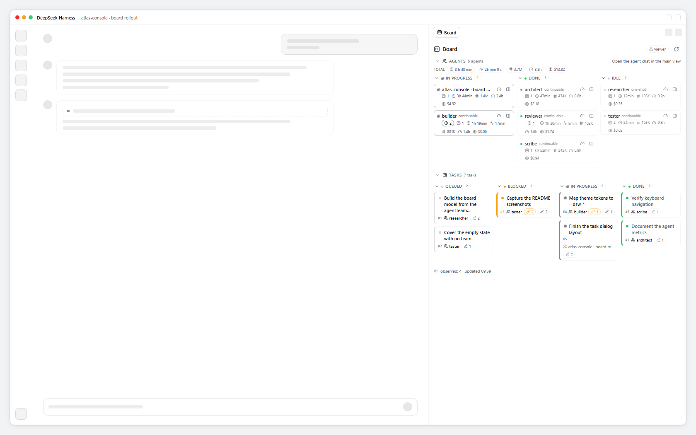
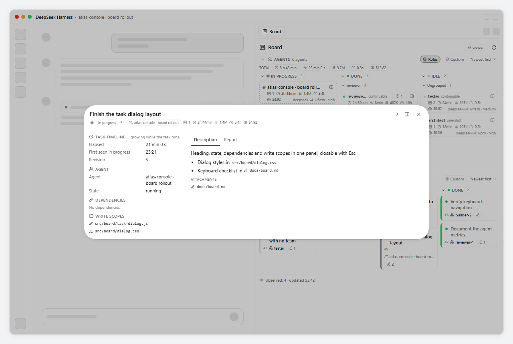
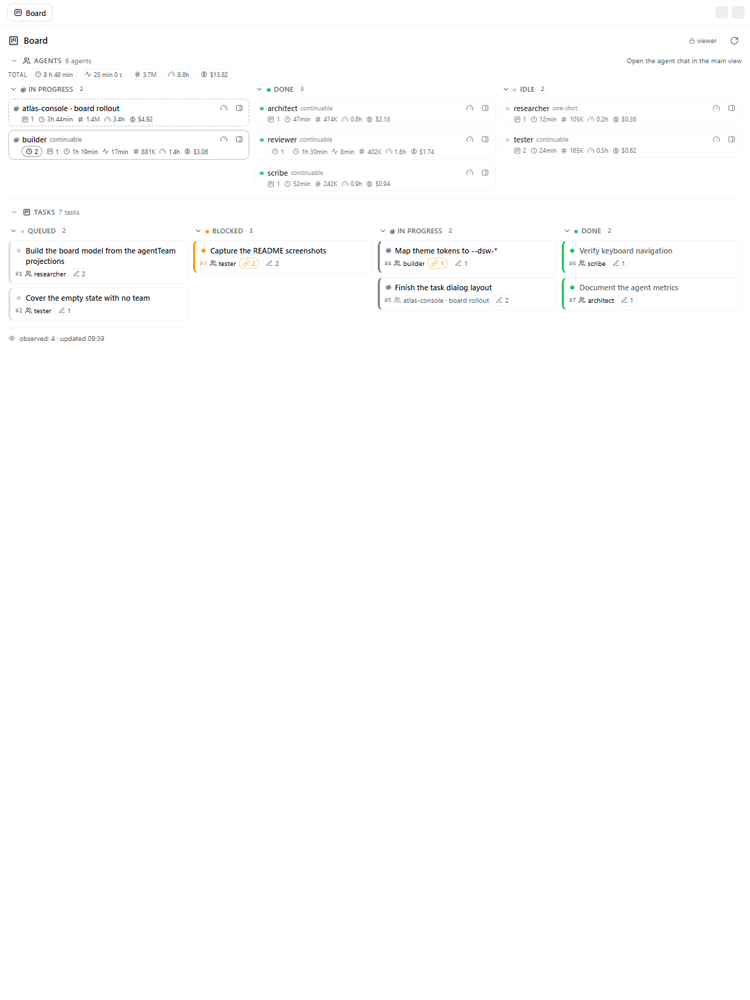
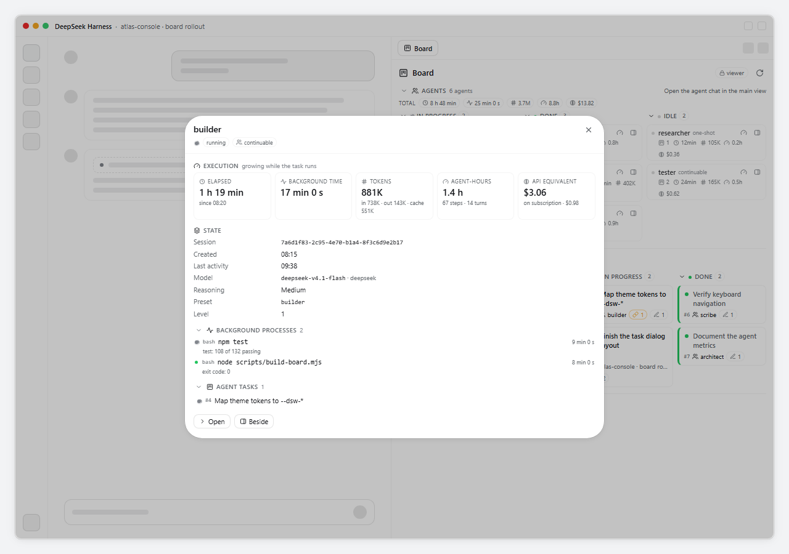
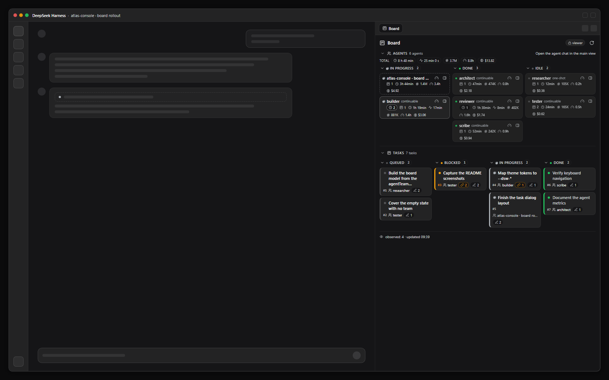
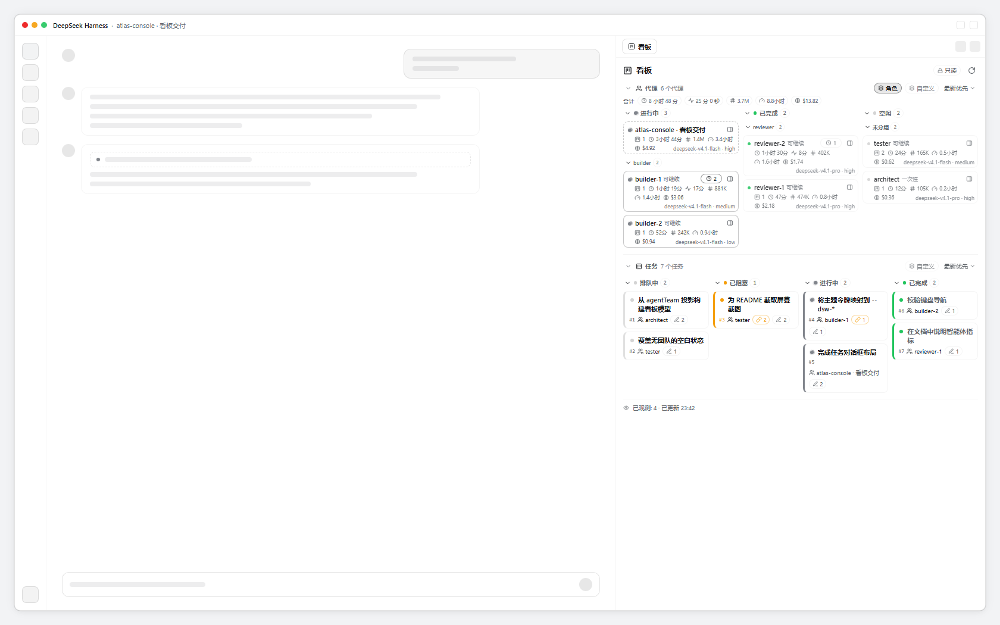

<h1 align="center">dsh-agent-team-viewer</h1>

<p align="center">Read-only Agent Team board for DeepSeek Harness</p>

<p align="center">
  <a href="https://github.com/RealWof/dsh-agent-team-viewer/releases/latest"></a>
  <a href="https://github.com/RealWof/dsh-agent-team-viewer/actions/workflows/ci.yml"></a>
  <a href="https://www.npmjs.com/package/dsh-agent-team-viewer"></a>
  <a href="LICENSE"></a>
</p>

<p align="center"><b>English</b> | <a href="README.zh.md">简体中文</a> | <a href="README.ru.md">Русский</a></p>

<p align="center"><a href="#install">Install</a> · <a href="#what-you-get">Overview</a> · <a href="#documentation">Documentation</a> · <a href="#compatibility">Compatibility</a> · <a href="#development">Development</a></p>

A read-only viewer of the DSH Agent Team board: the Lead session's task columns, the subagent tree with
its metrics, and the background processes each agent started — docked in the right sidebar.

<picture>
  <source media="(prefers-color-scheme: dark)" srcset="docs/screenshots/board-dark.png">
  
</picture>

<p align="center"><sub>Screenshots use fictional example data.</sub></p>

## Why another board?

The Subagents menu already renders the team task board, and the Team task tools are the only way to
change it. This plugin is deliberately not a second mutation surface: it reads the same `agentTeam`
projection of the Lead session and never claims, completes, reassigns or deletes a task. Its owner names
and agent rows are links that change what you are looking at, nothing more. What it adds is a second
reading of the same data: a board docked beside a session, plus the numbers a task record cannot carry.

## Install

- **DSH**: Settings → Plugins → Add plugin, then paste the npm name `dsh-agent-team-viewer` or point at
  a local checkout of this repository.
- **CLI**: `dsh plugin --profile web add dsh-agent-team-viewer` for the web UI, or
  `dsh plugin --profile desktop add dsh-agent-team-viewer` for the desktop app.
- **GitHub**: install from `github:RealWof/dsh-agent-team-viewer` in the UI or CLI.

Then open a session and click the board button immediately left of **Subagents** in the session header,
or the board card on the right panel's start page, or the **Board** tab. Team mode is only needed for
task changes; retained tasks and the subagent tree stay visible without it.

## Configuration

One optional setting, either in the profile row's `config` or in **Settings → Plugins**:

```yaml
- id: agent-team-viewer
  name: dsh-agent-team-viewer
  config:
    agentsLimit: 128
```

`agentsLimit` caps how many subagents the board walks and draws. The default is `-1` — no limit, so the
board follows the tree to the end. A session appends every new agent to the end of its catalog, so a cap
always hides the newest agents, which are the ones most likely to be working; set a positive number only
when a very large tree must bound the walk. The field is volatile, so the board reads the live value from
the settings document and an edit applies on the next board refresh.

## What you get

- **Task columns.** Queued, blocked, in progress and done, live from the Lead session's board. Status
  colours are the product's own: a grey dot, **amber** for a task pending on dependencies, a spinner for
  a running one, green for done. The layout drops to two columns and then one as the panel narrows, and
  a card carries only task facts — subject, id, the claiming agent (a link when it is a subagent),
  dependency and write-scope counts when it has them. No money, no timers.
- **Task dialog.** A card opens the task's blocks: description, its timeline (elapsed, first observed,
  finished, revision), the agent that claimed it, dependencies, and write scopes with overlap warnings.

<p align="center">
  
</p>

- **Agent groups.** The Lead and its subagent tree, grouped by the same statuses the columns use — in
  progress, done, idle — including agents that own no task. The Lead always opens its own group,
  so the main session never hides behind its workers. A row shows the tasks it owns, its run
  duration, tokens, agent-hours and API-equivalent cost.

<p align="center">
  
</p>

- **Agent dialog.** A row's gauge opens the five metrics in detail, the session facts (created, last
  activity, level, session id, model, provider, reasoning effort, preset), the **background processes**
  that agent started and the tasks it owns. A process row shows the command, state, elapsed time and the
  live progress line or the exit reason, running first. The row's clock chip counts every background job
  the agent owns and highlights while one is live; the row and the dialog also show the wall time those
  processes occupied next to the agent's own run time. Both the process list and the task list fold away
  and scroll when they grow. Attribution is read-only: the output tail and the stop control stay in the
  shipped **Jobs** popover.

<p align="center">
  
</p>

- **Totals.** One row above the groups adds up the run time, background time, tokens, agent-hours and
  API-equivalent cost of every agent of the tree, in the same order the agent rows use.

<p align="center">
  
</p>

## Features

| Area | What it shows |
|---|---|
| Board | four columns by task status, live from the `agentTeam` projection |
| Task dialog | description, timeline, agent block, dependencies, write scopes |
| Agents | the Lead plus its subagent tree, grouped by status, agents without tasks included |
| Metrics | tasks, run duration, background time, tokens, agent-hours (`llmMs + toolMs`), API-equivalent cost |
| Background jobs | a clock chip on the agent row and a foldable, scrollable read-only list in the agent dialog, joined by `owner` |
| Totals | run time, tokens, agent-hours and cost of the whole tree, in the agents' order |
| Navigation | name → main view, panel icon → beside the board; both dialogs close on navigation |
| Read-only | no task mutation of any kind |
| Team mode | optional for viewing; only task creation and changes need it |
| Locales | `en`, `zh`, `ru`, `ja`, `es`, `fr`, `de`, `pt` |
| Optional | [`dsh-cost-meter`](https://github.com/Han-1413141/dsh-cost-meter) for the money figure |

## Documentation

| Topic | Guides |
|---|---|
| Setup | [Install](#install) · [Install guide](docs/INSTALL.md) · [Troubleshooting](https://github.com/RealWof/dsh-agent-team-viewer/blob/main/docs/TROUBLESHOOTING.md) · [Compatibility](#compatibility) |
| Plugin page | [English](docs/DETAIL.md) · [中文](docs/DETAIL.zh.md) · [Русский](docs/DETAIL.ru.md) |
| Development | [Development guide](https://github.com/RealWof/dsh-agent-team-viewer/blob/main/docs/DEVELOPMENT.md) · [Build and test](#development) · [Changelog](CHANGELOG.md) |
| Project | [Contributing](https://github.com/RealWof/dsh-agent-team-viewer/blob/main/CONTRIBUTING.md) · [Security](https://github.com/RealWof/dsh-agent-team-viewer/blob/main/SECURITY.md) · [Code of Conduct](https://github.com/RealWof/dsh-agent-team-viewer/blob/main/CODE_OF_CONDUCT.md) · [MIT license](LICENSE) · [Issues](https://github.com/RealWof/dsh-agent-team-viewer/issues) |

## Read-only by design

The panel reads projections and nothing else: `agentTeam` for the tasks, `subagentCatalog` and
`subagentTiming` for the tree, `tokenUsage` and `sessionStats` for the numbers, `modelSelection` and
`agentPreset` for the session facts, the job rosters (`ctx.jobs`) for the clock chips, and the cost
meter's read API for money. It exposes no task action,
and no click in it can move work between states. Tasks change when the agents' Team task tools change
them; the board follows the same durable projection the Subagents menu shows.

## Cost

Money is the **API-equivalent** value of the tokens at list prices, not the wallet spend. On a
subscription the wallet spends nothing while the tokens still have a list price, and the cost tile reads
`on subscription · $0` (in the English UI) instead of hiding the equivalent. The figure comes from the
optional [`dsh-cost-meter`](https://github.com/Han-1413141/dsh-cost-meter) plugin: without it the money chip
is absent, the cost tile shows an em dash, and the agents header says the cost plugin is not installed.

## Locales

The panel follows the application language and ships eight dictionaries: English, Chinese, Russian,
Japanese, Spanish, French, German and Portuguese. Plugin-manager metadata is translated for the same
eight languages, and this README exists in English, Chinese and Russian.

<p align="center">
  
</p>

## Compatibility

- `engines.dsh`: `>=0.2.1-rc.5 <0.3.0`.
- Uses only client packages shipped with DSH: `@deepseek-ai/dsh-client-ui-conversation`,
  `@deepseek-ai/dsh-client-ui-sidebar-right`, `@deepseek-ai/dsh-client-ui-session` and
  `@deepseek-ai/dsh-client-locale`.
- Does not depend on the Agent Team UI package: it reads the `agentTeam` projection instead.
- [`dsh-cost-meter`](https://github.com/Han-1413141/dsh-cost-meter) is optional; everything except the money figure works without it.
- The client `Jobs` service (`ctx.jobs`) is optional too: without it the jobs chip and the jobs block
  are absent, and the rest of the panel is unchanged.
- Team mode is optional for viewing: the panel shows the session's retained tasks and its subagent tree
  with Team mode off, and says how to enable it. Agents can create or change tasks only while Team mode
  is on.

## Development

```sh
node scripts/build-client.js   # concatenate src/client/** into client.js
node --check client.js
node scripts/smoke.mjs         # headless: registration, renders, navigation, locale keys
```

`client.js` is generated — edit `src/client/**` and rebuild. The plugin's marketplace preview lives in
[docs/DETAIL.md](docs/DETAIL.md); the full layout, mock screenshots and release steps are in
[docs/DEVELOPMENT.md](https://github.com/RealWof/dsh-agent-team-viewer/blob/main/docs/DEVELOPMENT.md).

## License

MIT © 2026 RealWof. See [LICENSE](LICENSE).
