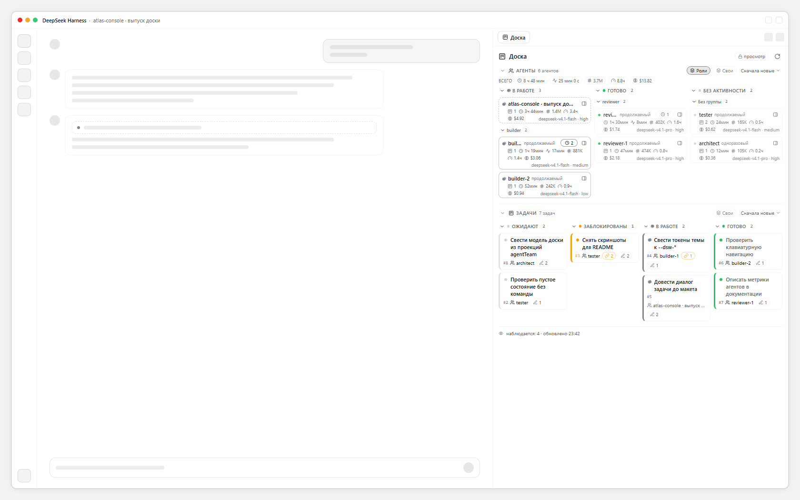
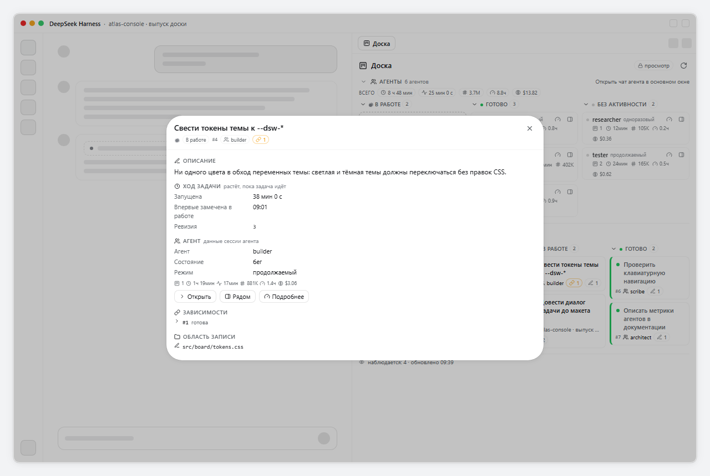
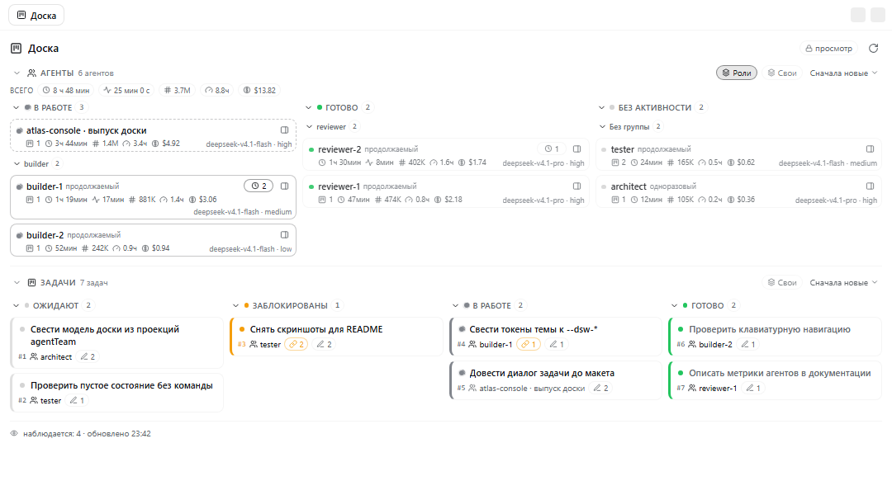
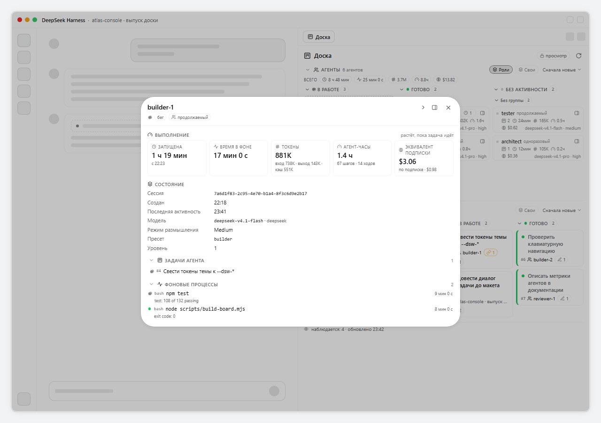
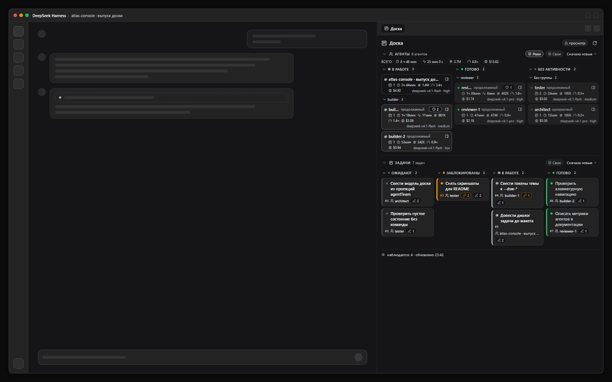
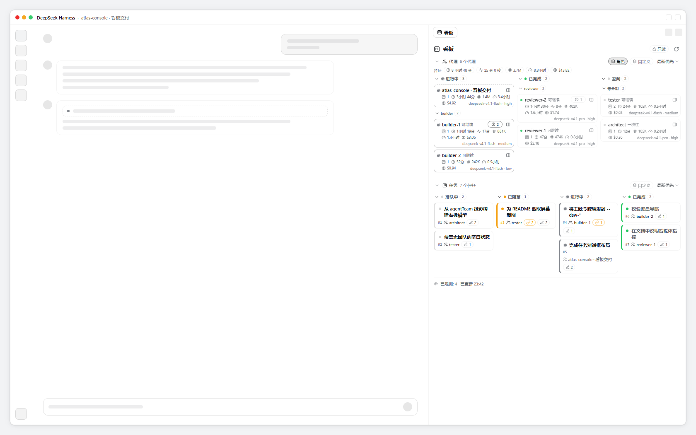

<h1 align="center">dsh-agent-team-viewer</h1>

<p align="center">Доска Agent Team для DeepSeek Harness только для чтения</p>

<p align="center">
  <a href="https://github.com/RealWof/dsh-agent-team-viewer/releases/latest"></a>
  <a href="https://github.com/RealWof/dsh-agent-team-viewer/actions/workflows/ci.yml"></a>
  <a href="https://www.npmjs.com/package/dsh-agent-team-viewer"></a>
  <a href="LICENSE"></a>
</p>

<p align="center"><a href="README.md">English</a> | <a href="README.zh.md">简体中文</a> | <b>Русский</b></p>

<p align="center"><a href="#установка">Установка</a> · <a href="#что-вы-получаете">Обзор</a> · <a href="#документация">Документация</a> · <a href="#совместимость">Совместимость</a> · <a href="#разработка">Разработка</a></p>

Просмотр доски Agent Team в DSH без права записи: колонки задач лид-сессии, дерево субагентов с
метриками и фоновые процессы каждого агента — в правой панели.

<picture>
  <source media="(prefers-color-scheme: dark)" srcset="docs/screenshots/board-dark-ru.png">
  
</picture>

<p align="center"><sub>На скриншотах — вымышленные данные.</sub></p>

## Зачем ещё одна доска?

Меню Subagents уже рисует доску задач команды, а менять задачи можно только инструментами Team. Этот
плагин намеренно не становится вторым местом записи: он читает ту же проекцию `agentTeam` лид-сессии и
никогда не берёт, не завершает, не переназначает и не удаляет задачи. Его имена исполнителей и строки
агентов — ссылки, которые меняют только то, на что вы смотрите; он добавляет второй взгляд на данные —
доску рядом с сессией и цифры выполнения, которых запись задачи не содержит.

## Установка

- **В DSH**: Настройки → Плагины → Добавить плагин, затем имя пакета `dsh-agent-team-viewer` или путь к
  локальной копии этого репозитория.
- **CLI**: `dsh plugin --profile web add dsh-agent-team-viewer` для веб-интерфейса или
  `dsh plugin --profile desktop add dsh-agent-team-viewer` для десктопного приложения.
- **GitHub**: установите так же из `github:RealWof/dsh-agent-team-viewer`.

Затем откройте сессию и нажмите кнопку доски сразу слева от **Subagents** в заголовке сессии, либо
карточку доски на стартовой странице правой панели, либо вкладку **Доска**. Режим Team нужен только для
изменения задач; сохранённые задачи и дерево субагентов видны и без него.

## Настройка

Одна необязательная настройка — в `config` строки профиля или в **Настройки → Плагины**:

```yaml
- id: agent-team-viewer
  name: dsh-agent-team-viewer
  config:
    agentsLimit: 128
```

`agentsLimit` — сколько субагентов доска обходит и рисует. По умолчанию `-1` — без лимита: доска идёт
по дереву до конца. Сессия дописывает каждого нового агента в конец каталога, поэтому любой потолок
скрывает самых новых агентов — тех, что чаще всего и работают; положительное число имеет смысл, только
если очень большое дерево нужно ограничить. Поле volatile, поэтому доска читает живое значение из
документа настроек, и правка применяется при следующем обновлении доски.

## Что вы получаете

- **Колонки задач.** Ожидают, заблокированы, в работе, готово — в реальном времени с доски лид-сессии.
  Цвета состояний — собственные цвета продукта: серая точка, **янтарная** для задачи, ждущей
  зависимости, вращающийся индикатор для идущей, зелёная для готовой. При сужении панели раскладка
  переходит с четырёх колонок на две, затем на одну. Карточка несёт только факты задачи: тему, id,
  агента, который её взял (ссылка, если это субагент), и — когда они есть — числа зависимостей и областей
  записи. Ни денег, ни таймеров.
- **Диалог задачи.** Карточка открывает блоки задачи: описание, её ход (запущена, впервые замечена,
  завершена, ревизия), агента, который её взял, зависимости и области записи с предупреждениями о
  пересечениях.

<p align="center">
  
</p>

- **Группы агентов.** Лид и его дерево субагентов, разложенные по тем же статусам, что и колонки, —
  в работе, готово, без активности; агенты без задач тоже в списке. Лид всегда идёт первым в своей
  группе, поэтому основная сессия не прячется за своими исполнителями. Строка показывает задачи
  агента, длительность прогона, токены, агент-часы и эквивалент стоимости по API.

<p align="center">
  
</p>

- **Диалог агента.** Значок датчика в строке открывает подробный вид пяти метрик, факты сессии
  (создана, последняя активность, уровень, id сессии, модель, провайдер, режим размышления, пресет),
  **фоновые процессы** этого агента и список его задач. Строка процесса показывает команду, состояние,
  прошедшее время и живой прогресс или причина завершения; идущие — первыми. Чип с часами в строке агента
  считает все его фоновые задачи и подсвечивается, пока хоть одна идёт; строка и диалог также показывают,
  сколько заняли фоновые процессы, рядом с собственным временем работы агента. Список процессов и список
  задач сворачиваются и прокручиваются, когда разрастаются. Это только атрибуция: вывод и кнопка
  остановки остаются в штатном поповере **Jobs**.

<p align="center">
  
</p>

- **Итоги.** Строка над группами складывает время работы, время в фоне, токены, агент-часы и эквивалент
  стоимости по API всех агентов дерева — в том же порядке, что и строки агентов.

<p align="center">
  
</p>

## Возможности

| Раздел | Что показывает |
|---|---|
| Доска | четыре колонки по статусу задачи, в реальном времени из проекции `agentTeam` |
| Диалог задачи | описание, ход задачи, блок агента, зависимости, области записи |
| Агенты | лид и его дерево субагентов по статусам, включая агентов без задач |
| Метрики | задачи, длительность, время в фоне, токены, агент-часы (`llmMs + toolMs`), эквивалент стоимости по API |
| Фоновые процессы | чип с часами в строке агента и сворачиваемый прокручиваемый список только для чтения в его диалоге, по владельцу `owner` |
| Итоги | время работы, токены, агент-часы и стоимость всего дерева — в порядке агентов |
| Навигация | имя → основное окно, значок панели → рядом с доской; при переходе оба диалога закрываются |
| Только чтение | никаких изменений задач |
| Режим Team | необязателен для просмотра; нужен только для создания и изменения задач |
| Языки | `en`, `zh`, `ru`, `ja`, `es`, `fr`, `de`, `pt` |
| Необязательно | [`dsh-cost-meter`](https://github.com/Han-1413141/dsh-cost-meter) для денежных значений |

## Документация

| Раздел | Материалы |
|---|---|
| Установка | [Установка](#установка) · [Руководство по установке](docs/INSTALL.md) · [Решение проблем](https://github.com/RealWof/dsh-agent-team-viewer/blob/main/docs/TROUBLESHOOTING.md) · [Совместимость](#совместимость) |
| Страница плагина | [English](docs/DETAIL.md) · [中文](docs/DETAIL.zh.md) · [Русский](docs/DETAIL.ru.md) |
| Разработка | [Руководство разработчика](https://github.com/RealWof/dsh-agent-team-viewer/blob/main/docs/DEVELOPMENT.md) · [Сборка и тесты](#разработка) · [Changelog](CHANGELOG.md) |
| Проект | [Участие](https://github.com/RealWof/dsh-agent-team-viewer/blob/main/CONTRIBUTING.md) · [Безопасность](https://github.com/RealWof/dsh-agent-team-viewer/blob/main/SECURITY.md) · [Кодекс поведения](https://github.com/RealWof/dsh-agent-team-viewer/blob/main/CODE_OF_CONDUCT.md) · [Лицензия MIT](LICENSE) · [Issues](https://github.com/RealWof/dsh-agent-team-viewer/issues) |

## Только чтение по замыслу

Панель читает проекции и ничего больше: задачи — из `agentTeam`, дерево — из `subagentCatalog` и
`subagentTiming`, числа — из `tokenUsage` и `sessionStats`, факты сессии — из `modelSelection` и
`agentPreset`, ростры заданий (`ctx.jobs`) — для чипов с часами, деньги — из API чтения плагина учёта.
Действий над задачей нет: задачи меняют инструменты
Team у агентов, а доска следует той же долговременной проекции, что показывает меню Subagents.

## Стоимость

Деньги — **эквивалент стоимости по API**: токены по прайс-листу, а не расход из кошелька. На подписке
кошелёк не тратит ничего, но у токенов остаётся цена по прайсу, и плитка стоимости пишет
`по подписке · $0` (в русском интерфейсе). Значение приходит из необязательного плагина
[`dsh-cost-meter`](https://github.com/Han-1413141/dsh-cost-meter); без него чипа нет, а плитка показывает тире.

## Языки

Панель следует языку приложения и поставляется с восемью словарями: английский, китайский, русский,
японский, испанский, французский, немецкий и португальский. Метаданные менеджера плагинов переведены для
тех же восьми языков, а README есть на английском, китайском и русском.

<p align="center">
  
</p>

## Совместимость

- `engines.dsh`: `>=0.2.1-rc.5 <0.3.0`.
- Используются только клиентские пакеты, поставляемые с DSH:
  `@deepseek-ai/dsh-client-ui-conversation`, `@deepseek-ai/dsh-client-ui-sidebar-right`,
  `@deepseek-ai/dsh-client-ui-session` и `@deepseek-ai/dsh-client-locale`.
- Зависимости от пакета интерфейса Agent Team нет: доска читает проекцию `agentTeam`.
- [`dsh-cost-meter`](https://github.com/Han-1413141/dsh-cost-meter) необязателен; без него работает всё, кроме денежного значения.
- Клиентский сервис `Jobs` (`ctx.jobs`) тоже необязателен: без него чип и блок процессов отсутствуют,
  остальная панель не меняется.
- Режим Team необязателен для просмотра: панель показывает сохранённые задачи сессии и дерево
  субагентов и при выключенном режиме, и подсказывает, как его включить. Создавать и менять задачи
  агенты могут только при включённом режиме.

## Разработка

```sh
node scripts/build-client.js   # собрать src/client/** в client.js
node --check client.js
node scripts/smoke.mjs         # безголовый тест: регистрация, рендеры, навигация, ключи языков
```

`client.js` генерируется — правьте `src/client/**` и пересобирайте. Страница плагина в каталоге —
[docs/DETAIL.md](docs/DETAIL.md); полное описание структуры, моков и релиза — в
[docs/DEVELOPMENT.md](https://github.com/RealWof/dsh-agent-team-viewer/blob/main/docs/DEVELOPMENT.md).

## Лицензия

MIT © 2026 RealWof. См. [LICENSE](LICENSE).
