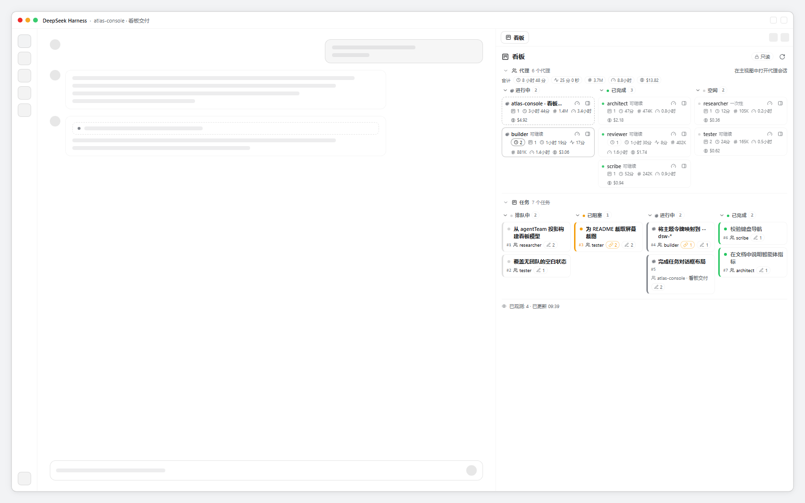
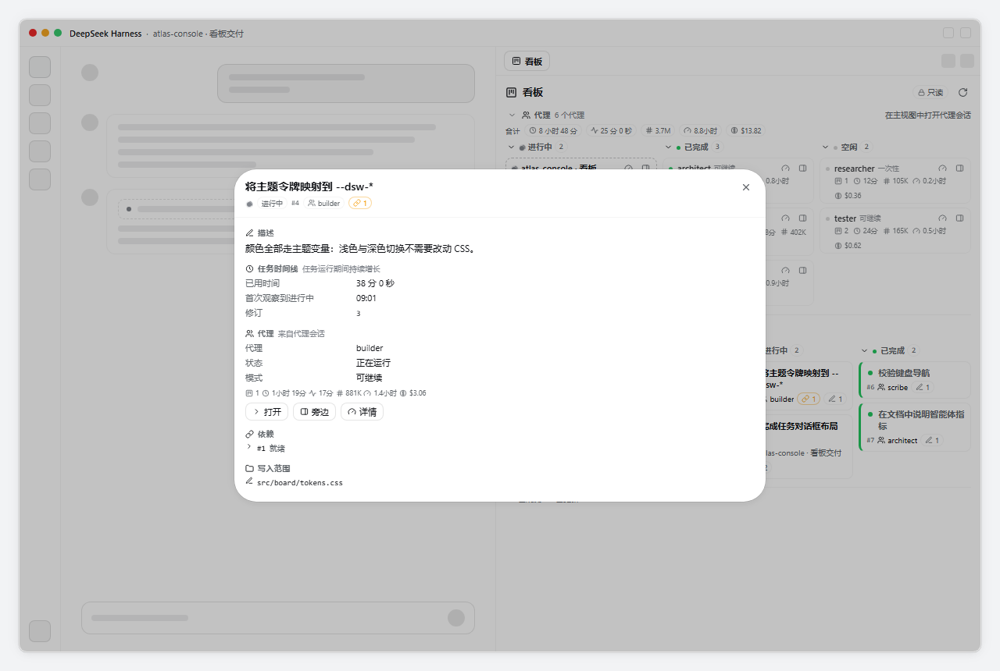
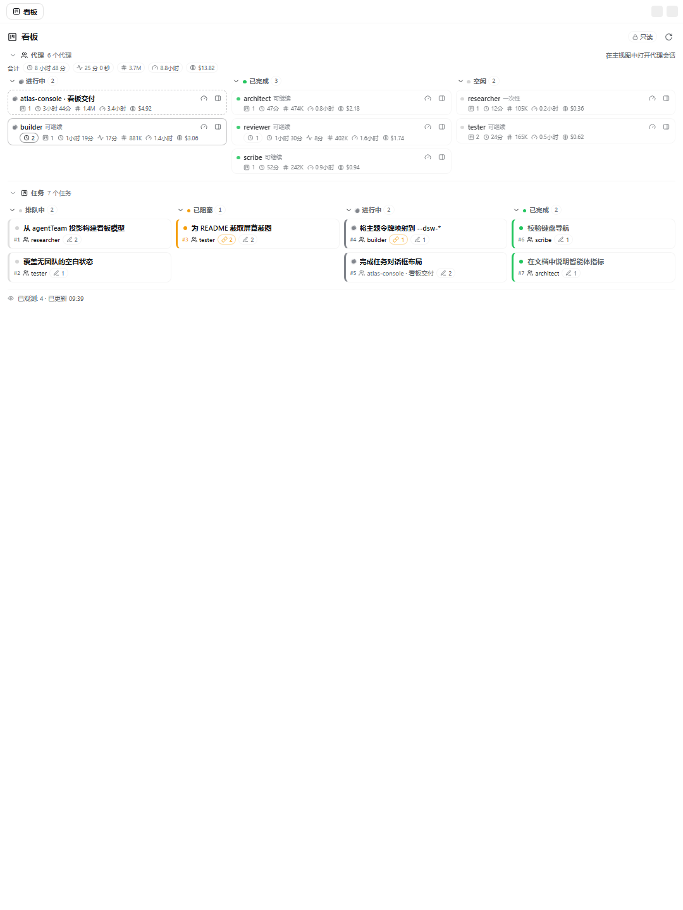
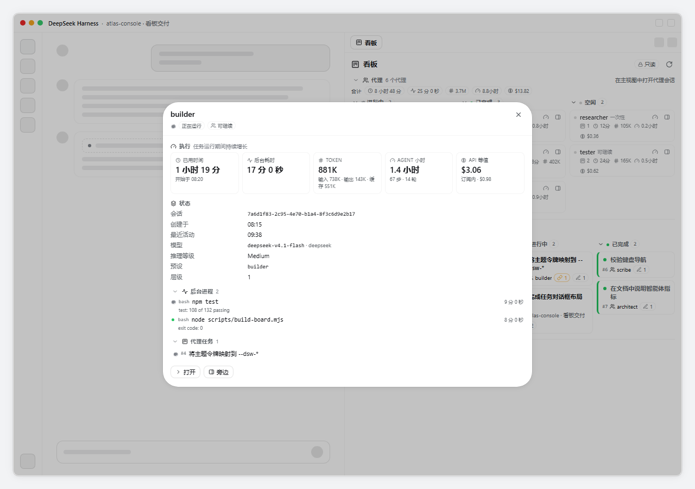
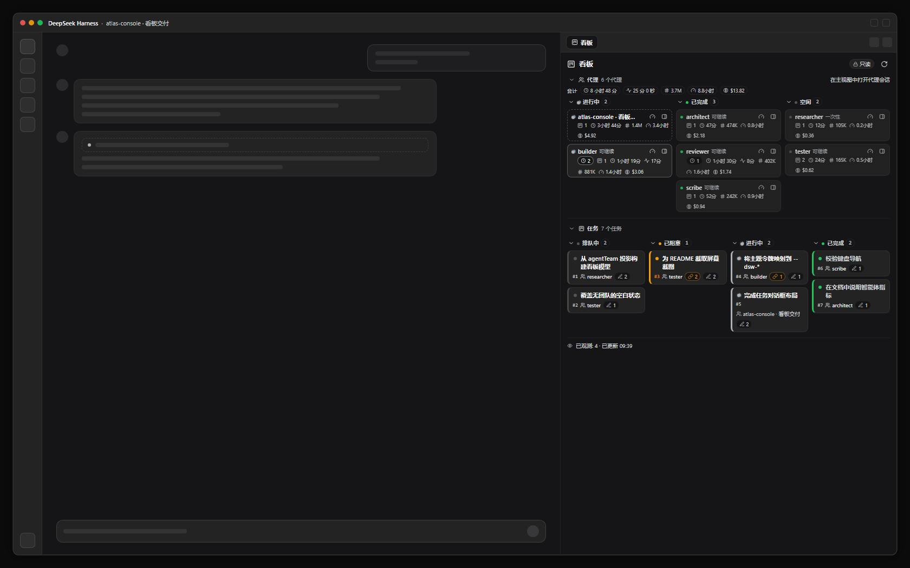
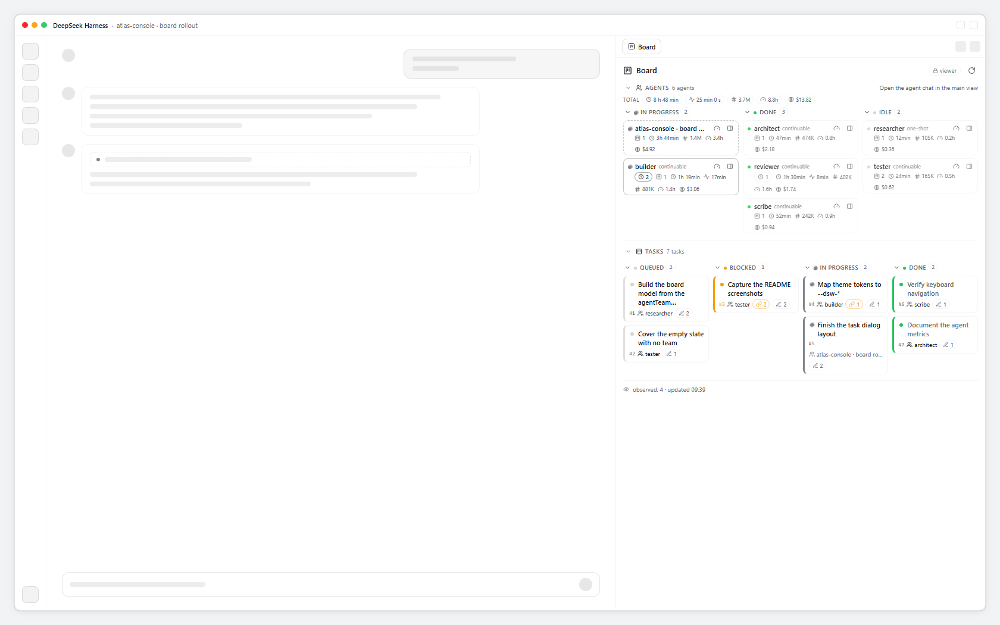

<h1 align="center">dsh-agent-team-viewer</h1>

<p align="center">DeepSeek Harness 的 Agent Team 看板只读查看器</p>

<p align="center">
  <a href="https://github.com/RealWof/dsh-agent-team-viewer/releases/latest"></a>
  <a href="https://github.com/RealWof/dsh-agent-team-viewer/actions/workflows/ci.yml"></a>
  <a href="https://www.npmjs.com/package/dsh-agent-team-viewer"></a>
  <a href="LICENSE"></a>
</p>

<p align="center"><a href="README.md">English</a> | <b>简体中文</b> | <a href="README.ru.md">Русский</a></p>

<p align="center"><a href="#安装">安装</a> · <a href="#你能看到什么">概览</a> · <a href="#文档">文档</a> · <a href="#兼容性">兼容性</a> · <a href="#开发">开发</a></p>

以只读方式查看 DSH Agent Team 看板：Lead 会话的任务列、带指标的代理树，以及每个代理启动的后台进程——全部停靠在右侧边栏。

<picture>
  <source media="(prefers-color-scheme: dark)" srcset="docs/screenshots/board-dark-zh.png">
  
</picture>

<p align="center"><sub>截图使用虚构的示例数据。</sub></p>

## 为什么还要一个看板？

Subagents 菜单本身就会绘制团队任务看板，而改写任务的唯一途径是 Team 任务工具。这个插件刻意不做第二个写入入口：它读取 Lead 会话中同一份 `agentTeam` 投影，从不领取、完成、改派或删除任务。卡片上的负责人名字和代理列表里的行都只是链接，只改变你正在看的内容。它增加的是对同一份数据的另一种读法——一块始终停靠在会话旁边的看板，以及任务记录本身并不携带的执行数据。

## 安装

- **DSH 界面**：设置 → 插件 → 添加插件，填入 npm 包名 `dsh-agent-team-viewer`，或指向本仓库的本地检出。
- **命令行**：Web 界面用 `dsh plugin --profile web add dsh-agent-team-viewer`，桌面应用用 `dsh plugin --profile desktop add dsh-agent-team-viewer`。
- **GitHub**：用同样的方式从 `github:RealWof/dsh-agent-team-viewer` 安装。

然后打开一个会话，点击会话头部紧挨着 **Subagents** 左侧的看板按钮，或右侧面板起始页上的看板卡片，或 **看板** 标签页。Team 模式只影响任务变更；已保留的任务和子代理树在关闭时仍然可见。

## 你能看到什么

- **任务列**。排队中、已阻塞、进行中、已完成四列，数据实时来自 Lead 会话的看板。状态颜色沿用产品自身的一套：灰色圆点；等待依赖的待处理任务为**琥珀色**；运行中为旋转指示；已完成为绿色。面板变窄时，布局先从四列降为两列，再降为一列。卡片只承载任务事实——标题、编号、领取任务的代理（子代理时为链接），以及存在时才出现的依赖数与写入范围数。不显示金额，也不显示计时。
- **任务对话框**。点击卡片可打开任务的分块信息：描述、时间线（已用时间、首次观察到、完成时间、修订号）、领取它的代理、依赖，以及带重叠警告的写入范围。

<p align="center">
  
</p>

- **代理分组**。Lead 及其子代理树，按与任务列相同的状态分组——进行中、已完成、空闲——不持有任务的代理也会列出。Lead 始终排在自己分组的第一行，主会话不会被它的执行者挡住。每一行显示它持有的任务数、运行时长、Token、Agent 小时和 API 等值费用。

<p align="center">
  
</p>

- **代理对话框**。点击某一行的仪表图标，可查看指标明细、会话信息（创建时间、最近活动、层级、会话 ID、模型、提供方、推理等级、预设）、该代理启动的**后台进程**以及它名下的任务。进程行显示命令、状态、已用时间，以及实时进度或退出原因；运行中的排在前面。代理行上的时钟标签统计该代理的全部后台任务，有任务运行时会高亮；代理行与对话框还会在代理自身运行时长旁显示后台进程占用的时间。进程列表与任务列表在内容变多时可以折叠和滚动。这里只做归属展示：输出与停止按钮仍留在产品自带的 **后台任务** 弹层中。

<p align="center">
  
</p>

- **合计**。分组上方的一行汇总整棵树所有代理的运行时长、后台耗时、Token、Agent 小时与 API 等值费用，顺序与代理行一致。

<p align="center">
  
</p>

## 功能一览

| 项目 | 内容 |
|---|---|
| 看板 | 按任务状态划分四列，实时读取 `agentTeam` 投影 |
| 任务对话框 | 描述、时间线、代理信息块、依赖、写入范围 |
| 代理 | Lead 及其子代理树，按状态分组，包含没有任务的代理 |
| 指标 | 任务数、运行时长、后台耗时、Token、Agent 小时（`llmMs + toolMs`）、API 等值费用 |
| 后台进程 | 代理行上的时钟标签，以及代理对话框中可折叠、可滚动的只读列表，按 `owner` 归属 |
| 合计 | 整棵树的运行时长、Token、Agent 小时与费用，顺序与代理一致 |
| 跳转 | 名称 → 主视图，面板图标 → 看板旁边；跳转时两个对话框都会关闭 |
| 只读 | 不执行任何任务变更操作 |
| Team 模式 | 查看时可选；只有新增或修改任务才需要 |
| 语言 | `en`、`zh`、`ru`、`ja`、`es`、`fr`、`de`、`pt` |
| 可选 | 由 [`dsh-cost-meter`](https://github.com/Han-1413141/dsh-cost-meter) 提供金额数据 |

## 文档

| 项目 | 内容 |
|---|---|
| 安装 | [安装](#安装) · [安装指南](docs/INSTALL.md) · [故障排查](https://github.com/RealWof/dsh-agent-team-viewer/blob/main/docs/TROUBLESHOOTING.md) · [兼容性](#兼容性) |
| 插件页面 | [English](docs/DETAIL.md) · [中文](docs/DETAIL.zh.md) · [Русский](docs/DETAIL.ru.md) |
| 开发 | [开发指南](https://github.com/RealWof/dsh-agent-team-viewer/blob/main/docs/DEVELOPMENT.md) · [构建与测试](#开发) · [Changelog](CHANGELOG.md) |
| 项目 | [贡献指南](https://github.com/RealWof/dsh-agent-team-viewer/blob/main/CONTRIBUTING.md) · [安全策略](https://github.com/RealWof/dsh-agent-team-viewer/blob/main/SECURITY.md) · [行为准则](https://github.com/RealWof/dsh-agent-team-viewer/blob/main/CODE_OF_CONDUCT.md) · [MIT 许可证](LICENSE) · [Issues](https://github.com/RealWof/dsh-agent-team-viewer/issues) |

## 设计上就是只读

面板只读取投影，别的一概不做：任务来自 `agentTeam`，代理树来自 `subagentCatalog` 与 `subagentTiming`，数字来自 `tokenUsage` 与 `sessionStats`，会话信息来自 `modelSelection` 与 `agentPreset`，时钟标签来自任务名册（`ctx.jobs`），金额来自费用插件的只读接口。它不提供任何任务操作，也不会有哪一次点击把任务在状态之间移动。任务只会在代理通过 Team 任务工具改动时变化；看板跟随的正是 Subagents 菜单展示的同一份持久化投影。

## 费用

金额是 Token 按标价折算的 **API 等值费用**，不是钱包支出。使用订阅时钱包不花钱，但 Token 依然有标价，费用卡片会写明 `订阅内 · $0`（界面为中文时），而不是隐藏等值费用。数据来自可选的 [`dsh-cost-meter`](https://github.com/Han-1413141/dsh-cost-meter) 插件：未安装时金额标签直接不显示，对话框的费用卡片显示破折号，代理分组标题会提示未安装费用插件。

## 语言

面板跟随应用语言，内置八套词典：英语、中文、俄语、日语、西班牙语、法语、德语和葡萄牙语。插件管理器的元数据同样覆盖这八种语言，README 提供英语、中文和俄语版本。

<p align="center">
  
</p>

## 兼容性

- `engines.dsh`：`>=0.2.1-rc.5 <0.3.0`。
- 只依赖 DSH 自带的客户端包：`@deepseek-ai/dsh-client-ui-conversation`、`@deepseek-ai/dsh-client-ui-sidebar-right`、`@deepseek-ai/dsh-client-ui-session` 和 `@deepseek-ai/dsh-client-locale`。
- 不依赖 Agent Team 界面包：直接读取 `agentTeam` 投影。
- [`dsh-cost-meter`](https://github.com/Han-1413141/dsh-cost-meter) 为可选依赖；未安装时除金额外一切照常。
- 客户端 `Jobs` 服务（`ctx.jobs`）同样是可选依赖：缺少它时后台进程标签与列表不显示，面板其余部分不变。
- Team 模式对查看是可选的：即使关闭，面板仍显示会话已保留的任务与子代理树，并提示如何开启。代理只有在 Team 模式开启时才能新增或修改任务。

## 开发

```sh
node scripts/build-client.js   # 把 src/client/** 拼成 client.js
node --check client.js
node scripts/smoke.mjs         # 无头冒烟：注册、渲染、跳转、语言键
```

`client.js` 是生成文件——请修改 `src/client/**` 后重新构建。插件市场的预览文档在 [docs/DETAIL.md](docs/DETAIL.md)；完整结构、模拟截图和发布流程见 [docs/DEVELOPMENT.md](https://github.com/RealWof/dsh-agent-team-viewer/blob/main/docs/DEVELOPMENT.md)。

## 许可证

MIT © 2026 RealWof。见 [LICENSE](LICENSE)。
